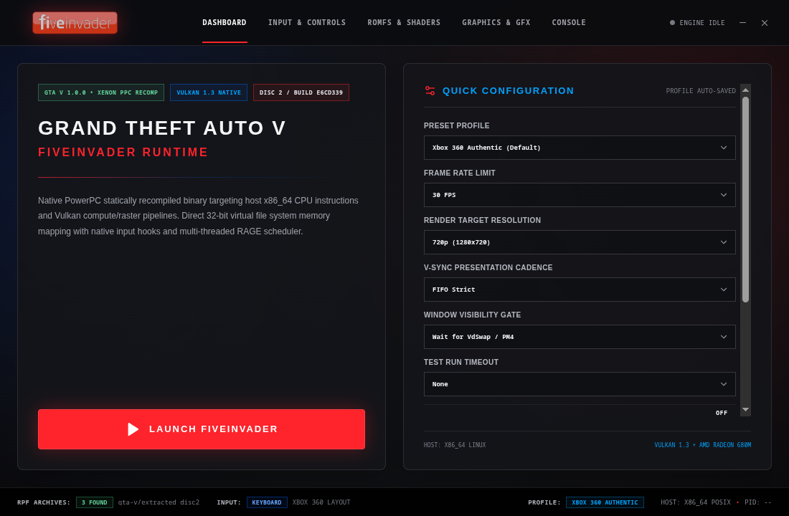
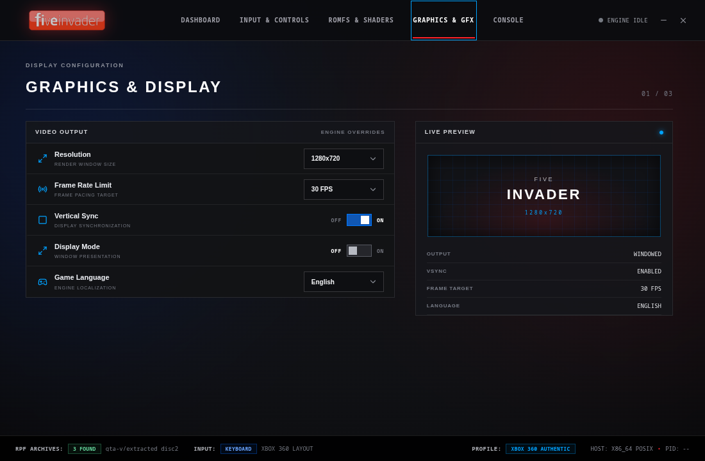
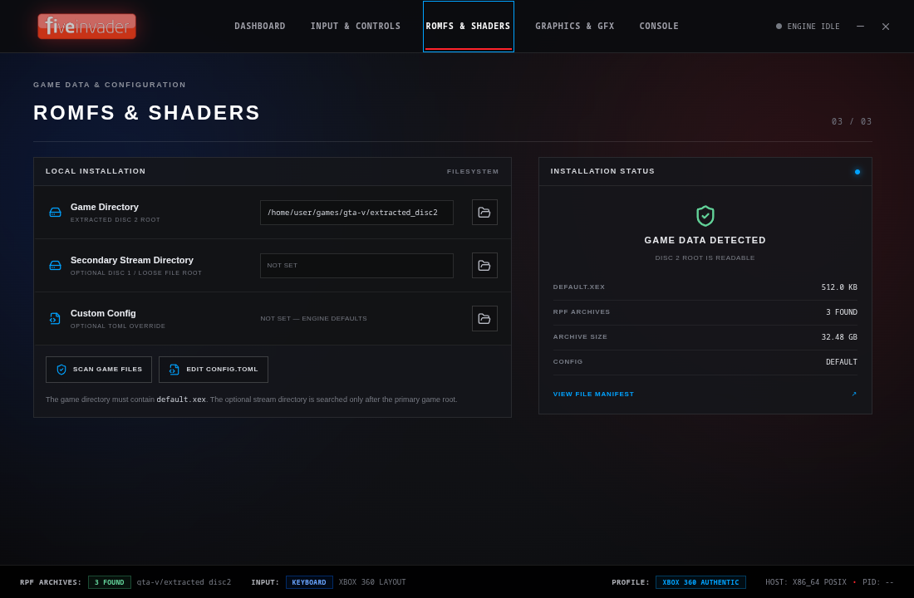

# FiveInvader

> [!WARNING]
> **Project Authorship & AI Attribution Notice**
> Approximately **90% of this codebase was authored, compiled, and debugged by Google's Antigravity**, operating under direct human supervision, technical direction, and architectural specification by [@triadwoozie](https://github.com/triadwoozie).

**FiveInvader** is an experimental native static recompilation of the Xbox 360 release of *Grand Theft Auto V* (Title ID: `545408A7`, Title Update & DLC build) targeting 64-bit Linux environments via Vulkan, with a native Android (AArch64) deployment roadmapped.

By pre-translating PowerPC Xenon machine code into native C++ using `XenonRecomp` and providing a dedicated runtime layer for Xbox 360 kernel and system interfaces, FiveInvader eliminates runtime JIT interpretation overhead. The runtime operates within the strict 512 MB guest physical footprint of the original 2013 RAGE engine, paired with a companion Electron + React launcher styled after modern recompilation suites (Bento grid dashboard, Scaleform-inspired styling, and runtime telemetry hooks).

---

## Architecture Overview

```
┌────────────────────────────────────────────────────────┐
│            FiveInvader Runtime Architecture            │
├────────────────────────────────────────────────────────┤
│                                                        │
│  [ Disc 2 / GoD Assets ]      [ Disc 1 Content Packs ] │
│  (common.rpf, xbox360a/b.rpf) (part0.rpf - part3.rpf)  │
│              │                             │           │
│              ▼                             ▼           │
│  ┌──────────────────────────────────────────────────┐  │
│  │            RAGE VFS & RPF7 Archive Parser        │  │
│  │    (fiDevice, fiStream, STFS Container Mounts)   │  │
│  └────────────────────────┬─────────────────────────┘  │
│                           ▼                            │
│  ┌──────────────────────────────────────────────────┐  │
│  │          Recompiled Guest PPC Binary (554 MB)    │  │
│  │        (XenonRecomp Native C++ Translation)      │  │
│  ├──────────────────────────────────────────────────┤  │
│  │  • Unified 512MB RAM Space (0x80000000 Base)     │  │
│  │  • Big-Endian GuestVaList Variadic ABI Engine    │  │
│  │  • PCR/TLS Subsystem Allocators (Slots 116/120)  │  │
│  │  • Buddy SBA Pool Clamps & Heap Cycle Mitigators │  │
│  │  • 64-Thread Worker Task Pool (CREATE_SUSPENDED) │  │
│  │  • Safe Indirect Branch / Jump Table Interceptors│  │
│  └────────────────────────┬─────────────────────────┘  │
│                           ▼                            │
│  ┌──────────────────────────────────────────────────┐  │
│  │     Graphics Pipeline & Command Processing       │  │
│  │    • Vd* Display Config & EDRAM Emulation        │  │
│  │    • Ring Buffer (0xA758E5C0) & PM4 Command Flow │  │
│  │    • Plume / Vulkan Swapchain Presentation       │  │
│  │    • Gated Window Presentation (VdSwap / PM4 > 0)│  │
│  └────────────────────────┬─────────────────────────┘  │
│                           │                            │
│             ┌─────────────┴─────────────┐              │
│             ▼                           ▼              │
│    [ Linux / x86_64 ]          [ Android / AArch64 ]   │
│    (Active Target)             (Roadmapped Target)     │
│                                                        │
└────────────────────────────────────────────────────────┘

```

---

## Technical Milestones & Implemented Fixes

### 1. Memory Arena, Kernel ABI & CRT Stabilization

* **Memory Layout & Zeroing**: Mapped the full 512 MB physical guest memory arena at base `0x80000000`. Initialized and zeroed the 17.9 MB Xenon data section, reaching the main CRT entry point at `0x83639888`.
* **AltiVec `dcbzl` Memory Overrun Prevention**: Replaced unaligned AltiVec cache-zeroing instructions (`dcbzl`) with bounded memory copies to prevent corrupted adjacent heap metadata.
* **Worker Thread Suspension & Semaphore Synchronization**: Resolved worker thread creation loops. Preserved `0x1` (`CREATE_SUSPENDED`) flags during `ExCreateThread`, resolved thread IDs via `GuestThreadHandle`, and patched `KeWaitForSingleObject` / `NtWaitForSingleObjectEx` fail-open hooks on boot synchronization handles (`0xC6053170`) to prevent infinite 16 ms/30 ms worker handshake stalls.

### 2. Thread-Local Allocators & SBA Buddy Churn Elimination

* **PCR/TLS Subsystem Mapping**: Resolved worker thread null pointer dereferences across `TLS + 116` (dictionary/string allocator), `TLS + 120` (scoped `sysMemAllocator`), and `TLS + 132` (fallback) by mapping all spawned threads to fallback allocator `0x83887168`.
* **Small Block Allocator (SBA) Loop Resolution**: Addressed a critical runaway loop between `sub_83194A08` and `sub_8248EAE0` that produced over 3.4 million allocation/deallocation attempts in 20 seconds. Handled the `0xFFFE` (65534) sentinel return on exhausted/uninitialized SBA buckets and patched circular doubly-linked-list unlinking in `imports.cpp`.
* **Heap Free / Cycle Detection (`sub_8255DC88`)**: Mitigated circular pointer traversals in secondary heap teardowns, allowing the engine to successfully transition out of heap initialization loops.

### 3. Indirect Dispatch Guarding & Jump Table Restoration

* **PPC Indirect Function Call Guards**: Xenon indirect branch dispatch (`bctrl` via `ctr.u32`) was triggering segmentation faults at host addresses (e.g., `0xd739ac3` in `sub_8351A9E8`) due to unmapped pointers wrapping outside `PPC_CODE_BASE`. Implemented strict bounds checking across object pointers and vtable targets in `imports.cpp`.
* **String Formatting Switch-Table Interception**: PowerPC switch tables in CRT string formatting routines (`vsnprintf` / `sub_8362B5E0` targeting `0x8362BAB4`) were routing into `UnmappedIndirectHandler`. Added explicit symbol mappings and guarded forward wrappers for jump table targets (`sub_829855F8`, `sub_82985550`, `sub_831E2DB8`, `sub_831E3240`, `sub_829856D0`).
* **State Transition Dispatch**: Recovered the worker semaphore handoff in `sub_82577590`; the worker barrier now completes and the runtime reaches `VdSwap: 1`. The overall RAGE state machine is still in State 1, so State 2 initialization and title rendering remain open.

### 4. RPF7 Virtual File System (VFS) & Asset Parsing

* **Archive Extraction & Ingestion**: Supported big-endian RPF7 (`0x52504637`) archive mounting and TOC traversal for `xbox360a.rpf`, `xbox360b.rpf`, and `common.rpf`.
* **Radix Trie & XML Ingestion**: Native switch implementations bypassed MSVC CRT jump-table crashes in XML token parsing (`sub_831CB460`, `sub_831CC260`), enabling end-to-end ingestion of `installpartitions.meta` and `standard_scripted.meta`.

### 5. Allocator, Stream Reader & Dispatch Stabilization

* **Large-Block Free-List / Critical Section Stabilization**: Bounded the circular free-list walk in `sub_8363E870` and routes corrupt-list exits through allocator cleanup, preventing the `0x40000618` lock from remaining held. Null results in `sub_8321CE00` now follow the guest cleanup path.
* **Stream and Allocation Bounds**: Resource-stream lookup/results reject pointers below `0x40000000` and outside guest memory. `sub_8255DC20` and `sub_8363FCB0` reject oversized unsigned-underflow values (including `0xFEFFFFFF`) before they can become runaway allocations or copies.
* **Automated Recompiled-Code Patches**: `tools/patch_ppc_xml_switch.py` applies XML switches and guarded indirect dispatch to `ppc_recomp.263.cpp`, `.268.cpp`, `.269.cpp`, `.328.cpp`, and `.330.cpp`. It handles the XML switch dispatch at `0x831CB4A8`, worker variant dispatch at `0x8321D35C`, the `0x83223EDC`–`0x83223EFC` target range, and `0x8362BE00`, alongside allocator and stream guards including the low-address lookup protection in `sub_83215B40`.

### 6. Graphics Bootstrap & Presentation Controls

* **Command Stream & EDRAM**: Ring buffer active at `0xA758E5C0` (8 KB buffer); consumes Type 3 PM4 command packets (`ME_INIT`, opcode `0x48`, count 18).
* **Gated Window Visibility**: By default, the window stays hidden until active rendering occurs (`VdSwap > 0 || PM4 > 0`). `--window-gate immediate` can show it at startup for diagnostics.

---

## Companion Launcher (Electron + React)

FiveInvader includes a native companion launcher matching modern recompilation dashboards (Bento-grid modular design, Scaleform dark palette with Siren Red `#FF1E27` and Police Blue `#0066FF` accents):

* **Bento Status Dashboard**: Runtime status, game-data inspection, controller configuration, streaming logs, and a live CLI preview.
* **Persisted Runtime Options**: Editable primary game path, optional secondary loose-file/Disc 1 stream path, resolution presets (`1280x720`, `1920x1080`, `2560x1440`), `30/60/uncapped` FPS, FIFO/Mailbox/Immediate selection, and immediate/render-gated window visibility.
* **Debug & Test Controls**: MangoHud and Vulkan validation environment toggles, allocator/VFS telemetry, optional run-log files, and `None/20s/30s/60s` launcher timeouts. Mailbox currently maps to FIFO because the render interface exposes only enabled/disabled VSync.

### Launcher Screenshots

<p align="center">
  
  
  
</p>

---

## Current Status

```
[✓] Step 1: Toolchain, Linker & Base Binary Setup (100%)
[✓] Step 2: Memory Arena, Allocators & CRT Entry (100%)
[✓] Step 3: Threading Model, Sync Primitives & ABI (100%)
[✓] Step 4: Base VFS, Radix-Trie & XML Metadata Ingestion (100%)
[✓] Step 5: SBA Buddy Allocator & Heap Cycle Resolution (100%)
[✓] Step 6: Indirect Dispatch Guarding & State 1 Worker Barrier Recovery (100%)
[▶] Step 7: State 1 -> State 2 Worker Barrier & grcDevice Initial Hand-off (In Progress)
[ ] Step 8: Full PM4 Command Packet Interpretation & Draw Loop
[ ] Step 9: Title Screen & Legal Splash Presentation
[ ] Step 10: Android / AArch64 Cross-Compilation & Port (Roadmapped)

```

| Subsystem | Progress | Status | Notes |
| --- | --- | --- | --- |
| **Toolchain & Link** | **100%** | Stable | Compiles cleanly to a 554 MB native binary via Ninja/Clang. |
| **Memory & Allocators** | **100%** | Stable | SBA buddy loops patched; TLS slots 116, 120, 132 mapped; heap cleanup loops passed. |
| **Threading & Sync** | **95%** | Active | 64-thread pool operational; boot worker handshake (`0xC6053170`) fail-open hooked. |
| **Variadic ABI & Dispatches** | **100%** | Stable | Native `GuestVaList` active; libc jump tables and indirect `bctrl` guarded. |
| **VFS & Metadata** | **100%** | Stable | `installpartitions.meta`, `standard_scripted.meta`, and RPF7 TOCs verified. |
| **RAGE State Machine** | **80%** | Active | Worker barrier completes; latest observed state remains State 1. |
| **GPU Ring Buffer & GFX** | **50%** | Active | `ME_INIT` parsed; window presentation gated to active `VdSwap` / PM4 frames. |
| **Companion Launcher** | **95%** | Stable | Persisted game/stream paths, display/window options, debug toggles, timeout and log capture wired. |
| **Android / AArch64 Port** | **0%** | Roadmapped | Planned post-desktop stabilization via Android NDK & mobile Vulkan. |

---

For the exact current worker-barrier handoff and next rendering milestones, see [`docs/STATUS_AND_NEXT_STEPS.md`](docs/STATUS_AND_NEXT_STEPS.md).

## Building & Running

### Prerequisites

* Clang / LLVM toolchain supporting C++20
* Ninja build system
* Vulkan SDK (1.3+)
* SDL2 development libraries
* Node.js & npm (for building the companion launcher)

### Building the Native Engine

Build with low process and I/O scheduling priorities:

```bash
nice -n 19 ionice -c 3 ninja -C build -j 3 -l 4.0 FiveInvader

```

### Running Test Traces

Run with a process timeout and pass the extracted game directory:

```bash
timeout -s SIGKILL 20s nice -n 19 ionice -c 3 ./build/FiveInvader/FiveInvader \
  --game-dir /path/to/extracted_disc2

```

### Building & Launching the UI

```bash
cd launcher
npm install
npm run build
npm start

```
