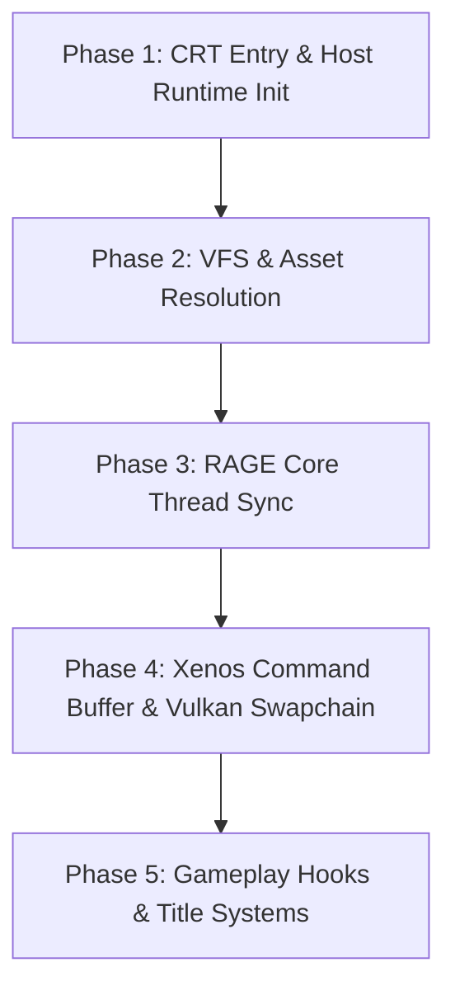

# FiveInvader Architecture & Bringup Phases

**Project Target**: Grand Theft Auto V (Xbox 360 Title ID `545408A7`, Retail `default.xex`)  
**Architecture**: Static Binary Recompilation (PPC64 -> x86_64 C++ via XenonRecomp)  
**Binary Output**: `FiveInvader` ELF executable (~554 MB)

---

## 1. Binary & Build Architecture

### 1.1 High-Level Component Layout
```
+------------------------------------------------------------------------+
|                              FiveInvader                               |
|                          (Main Host Binary)                            |
+------------------------------------------------------------------------+
      |                                              |
      v                                              v
+-----------------------------+        +---------------------------------+
|      FiveInvaderLib         |        |         FiveInvader Host        |
| (Static Recompiled Library) |        |        (Emulation Runtime)      |
+-----------------------------+        +---------------------------------+
| * 374 PPC chunks            |        | * Kernel & XAM HLE              |
|   (ppc_recomp.0..373.cpp)   | <----> | * VFS File Serving & Mapped RPF |
| * Indirect branch table     |        | * Memory Subsystem (1:1 Map)    |
|   (ppc_indirect.cpp)        |        | * Guest Threading & Fibers      |
| * Function pointer mappings |        | * Plume Vulkan Render Pipeline  |
+-----------------------------+        +---------------------------------+
```

### 1.2 Binary Size & Translation Model
- **Input Executable**: Xbox 360 retail PE/XEX executable `default.xex` (26,628,096 bytes).
- **Code Decomposition**: XenonRecomp translates the lifted PowerPC assembly into **374 C++ translation units** (`ppc_recomp.0.cpp` through `ppc_recomp.373.cpp`), compiled into the static archive `libFiveInvaderLib.a`.
- **Final Linked Binary**:
  - Size: ~554 MB (with debug symbols).
  - Linker: `lld` (`-fuse-ld=lld`) with strict low process and I/O priority (`nice -n 19 ionice -c 3`).
- **Memory Contract**:
  - 1:1 guest physical address mapping to host memory base `g_memory.base`.
  - Zero-initialized contiguous guest memory window `0x82000000 - 0x831F0000` (17.9 MB) cleared before entrypoint transfer.

### 1.3 Rendering Pipeline (`PLUME_SDL_VULKAN_ENABLED`)
- The host rendering pipeline uses the Plume abstraction library interfacing with Vulkan 1.3 (RADV/Mesa on Linux).
- Windows are initialized using SDL2 with `SDL_WINDOW_VULKAN` surface capability.
- Backbuffer formats and swapchain latency:
  - Format: `BACKBUFFER_FORMAT` (B8G8R8A8_UNORM / R8G8B8A8_UNORM)
  - VSync and present wait enabled based on host device capabilities.

---

## 2. Stub & Quarantine Registry

### 2.1 Kernel / XAM HLE Import Stubs (`imports.cpp`)

| Symbol Name | Classification | Risk Level | Description & Implementation State |
| :--- | :--- | :--- | :--- |
| `__imp__ExAllocatePool` | Memory Management | **Boot-Critical** | Routes to `g_userHeap.Alloc()`, zeroes memory, returns mapped virtual guest pointer. |
| `__imp__ExAllocatePoolTypeWithTag` | Memory Management | **Boot-Critical** | Routes to `g_userHeap.Alloc()`, logs tag and pool type, returns mapped virtual guest pointer. |
| `__imp__ExFreePool` | Memory Management | **Boot-Critical** | Translates guest virtual address and frees host block in `g_userHeap`. |
| `__imp__MmMapIoSpace` | Hardware / IO | **Boot-Critical** | Resolves 64-bit/32-bit physical addresses; falls back to allocated page if zero. |
| `__imp__NtYieldExecution` | Threading | **Boot-Critical** | Calls `std::this_thread::yield()`, returns `STATUS_SUCCESS`. |
| `__imp__XexLoadImage` | Module Loader | **Boot-Critical** | Logs module name; provides synthetic module handle `0x82000000` to prevent null deref. |
| `__imp__XexUnloadImage` | Module Loader | Normal | No-op stub returning `STATUS_SUCCESS`. |
| `__imp__XamUserGetAge` | User / Profile | Safe No-Op | Writes age `25` into guest output buffer; returns `0`. |
| `__imp__XamUserGetAgeGroup` | User / Profile | Safe No-Op | Writes age group `3` (Adult) into guest output buffer; returns `0`. |
| `__imp__XamUserGetDeviceContext` | User / Profile | Safe No-Op | No-op stub returning `0`. |
| `__imp__XAudioEnableDucker` | Audio | Safe No-Op | Audio ducking toggle; no-op stub returning `0`. |
| `__imp__XAudioGetDucker*` | Audio | Safe No-Op | Stubs for attack, release, hold, threshold; return `0`. |
| `__imp__KeSetCurrentProcessType` | Kernel / Thread | Safe No-Op | Sets process type flag; no-op stub returning `0`. |
| `__imp__VdSetDisplayModeOverride` | Video / Display | Safe No-Op | Video mode override; returns `0`. |
| `__imp__NtWriteFileGather` | File IO | Normal | No-op stub returning `0`. |
| `__imp__NetDll_XHttp*` | Networking | Safe No-Op | HTTP telemetry stubs (Open, Send, Receive, Read, Write, DoWork). |
| `__imp__NetDll_XNet*` | Networking | Safe No-Op | Network key, DNS lookup, Connect, and socket option stubs. |
| `__imp__XampXAuth*` | Authentication | Safe No-Op | Title auth and token generation stubs returning `0`. |
| `__imp__XamShow*UI` | UI Overlays | Safe No-Op | Keyboard, Marketplace, and Friend Request modal stubs. |
| `__imp__XamBackgroundDownload*` | Background Tasks| Safe No-Op | Content download queries returning `0`. |
| `__imp__XamContentResolve` | Content / VFS | Normal | Resolves content roots; handled via VFS mapping. |
| `__imp__XamSwapDisc` / `Cancel` | Disc Handling | Safe No-Op | Multi-disc swap requests; returns `0`. |

### 2.2 Quarantined Legacy GTA IV Hooks
To prevent unresolved symbols and mismatched function signatures from GTA IV, legacy hooks are quarantined under `#if 0 ... #endif` with `// TODO: GTA V address mapping`:

1. **`FiveInvader/gpu/video.cpp`**:
   - `sub_829D1758` (GTA IV shader compilation hook).
   - `sub_829D8860` (GTA IV draw primitive call-counter).
2. **`FiveInvader/patches/audio_patches.cpp`**:
   - Legacy GTA IV audio player hook addresses.
3. **`FiveInvader/patches/save_hooks.cpp`**:
   - Legacy GTA IV save-game serializer offsets (`sub_824B9140`, etc.).
4. **`FiveInvader/patches/player_limit_patches.cpp`**:
   - Legacy GTA IV multiplayer player limit tables.

---

## 3. Five-Phase Bringup Master Plan



### Phase 1: CRT Entry & Host Runtime Init (Current Status: PASSED)
- [x] Compile and link 374 recompiled PPC modules into host executable.
- [x] Zero-initialize memory regions `0x82000000 - 0x831F0000`.
- [x] Initialize guest heaps (`g_userHeap`) and memory structures.
- [x] Execute entrypoint `0x83639888` via `GuestThread::Start`.

### Phase 2: VFS & Asset Resolution (Current Status: IN PROGRESS)
- [x] Index extracted game assets (`common.rpf`, `xbox360a.rpf`, `audio_rel.rpf`).
- [x] Map `game:\`, `dvd:\`, `common:\`, and `platform:\` to physical host assets.
- [ ] Implement direct RPF-archive read streaming without full filesystem extraction.
- [ ] Verify `common/data/levels/gta5/` data loading.

### Phase 3: RAGE Core Thread Synchronization
- [ ] Validate PowerPC reservation primitives (`lwarx`, `stwcx.`) under multithreading.
- [ ] Monitor RAGE worker thread pool creation and spin-wait loops.
- [ ] Intercept watchdog timers to prevent premature thread termination.

### Phase 4: Xenos Command Buffer & Vulkan Swapchain
- [x] Establish Vulkan rendering device and surface via Plume.
- [ ] Intercept RAGE PM4 packet streams from GPU command ringbuffer (`VdInitializeRingBuffer`).
- [ ] Translate Xbox 360 shader microcode (FXC) to SPIR-V / Vulkan pipelines.
- [ ] Present first rendered frame in window swapchain.

### Phase 5: Gameplay Hooks & Title Systems
- [ ] Map GTA V native function dispatch table (`rage::scrEngine`).
- [ ] Re-enable and adapt input patches for keyboard/mouse vehicle and on-foot controls.
- [ ] Port save-game serialization hooks to GTA V formats.
- [ ] Wire community P2P multiplayer session tracker.
